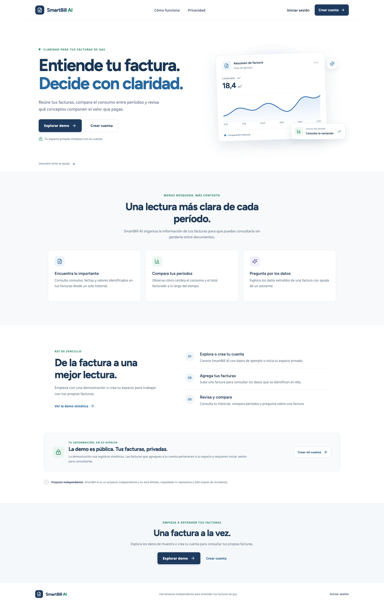
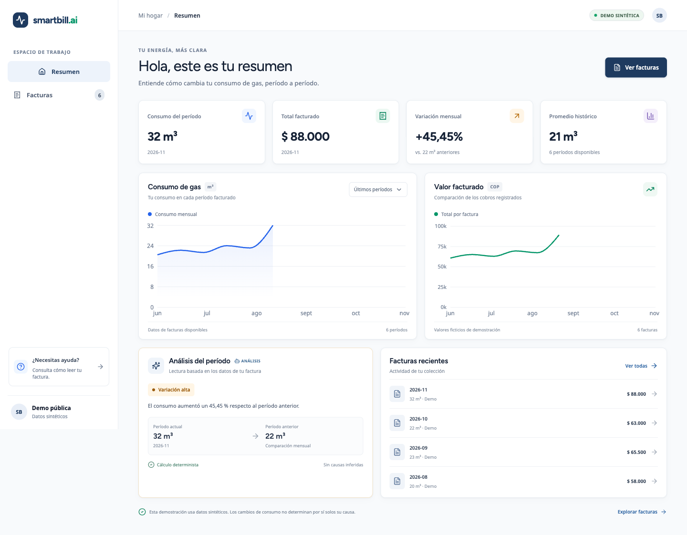

# SmartBill AI

SmartBill AI organiza datos visibles de facturas de gas para consultar consumo, conceptos facturados y cambios entre períodos. Es un proyecto personal de portafolio, independiente y **no oficial de Gases de Occidente (GdO)**: no representa a la empresa, no tiene su aval ni se integra con sus sistemas.

La aplicación ofrece una demo pública con valores sintéticos y un espacio privado por cuenta para facturas cargadas localmente. Las heurísticas de variación son demostrativas, no criterios oficiales ni indicadores de seguridad. Un aumento de consumo no demuestra una fuga ni su causa.

## Funciones

- Landing pública con acceso a la demo, registro e inicio de sesión.
- Dashboard sintético en `/demo`; no requiere cuenta.
- Cuentas con correo y contraseña, sesión por cookie `HttpOnly` y protección CSRF para operaciones privadas.
- Facturas asociadas al propietario de la cuenta, colecciones privadas y consultas aisladas por usuario.
- Extracción de PDF con PyMuPDF, sin OCR. Los campos no identificados quedan ausentes con advertencias.
- Análisis determinista de consumo y chat asociado a la factura.
- DigitalOcean Inference opcional; sin clave, el modo determinista permite usar el chat.

La colección sintética contiene junio a noviembre de 2026: 19, 21, 20, 23, 22 y 32 m³. El último período presenta una variación de aproximadamente 45,45 % respecto a octubre. Los valores COP son ficticios.

## Rutas de la aplicación

| Ruta | Acceso | Función |
|---|---|---|
| `/` | Público | Landing y explicación del producto |
| `/demo` | Público | Dashboard con historial sintético |
| `/login` | Público | Inicio de sesión |
| `/registro` | Público | Crear cuenta |
| `/app` | Requiere cuenta | Facturas, carga, dashboard y chat privados |

## Requisitos

- Python 3.12 o posterior
- Node.js 20 o posterior y npm

## Instalación y ejecución local

Abre dos terminales en la raíz del proyecto.

### Backend

```bash
cd backend
python3 -m venv .venv
source .venv/bin/activate
python -m pip install --upgrade pip
pip install -r requirements.txt
cp .env.example .env
python -m uvicorn app.main:app --reload --host 127.0.0.1 --port 8000
```

En Windows PowerShell, activa el entorno con `.venv\Scripts\Activate.ps1`. Al iniciar, el backend aplica la migración SQLite compatible con la tabla existente, crea las tablas nuevas y carga la colección sintética. Verifica `http://localhost:8000/health` y consulta OpenAPI en `http://localhost:8000/docs`.

### Frontend

En otra terminal:

```bash
cd frontend
npm ci
cp .env.example .env
npm run dev -- --host 127.0.0.1
```

Abre `http://localhost:5173`. La URL de backend se controla con `VITE_API_BASE_URL`.

## Configuración

Los archivos `.env.example` contienen valores locales sin secretos. Ajusta `backend/.env`:

| Variable | Valor inicial | Uso |
|---|---|---|
| `ENVIRONMENT` | `development` | En `production`, la cookie de sesión se marca `Secure` |
| `DATABASE_URL` | `sqlite:///./smartbill.db` | Base local; se crea dentro de `backend/` al ejecutar desde esa carpeta |
| `FRONTEND_ORIGIN` | `http://localhost:5173` | Origen exacto permitido para CORS y validación de `Origin` |
| `PUBLIC_DEMO` | `false` | `true` limita el acceso de datos a la colección sintética y bloquea cargas privadas |
| `SESSION_COOKIE_SECURE` | no definido (`false`) | Opcional; fuerza el atributo `Secure` en la cookie. En `ENVIRONMENT=production` ya se activa automáticamente |
| `LLM_BASE_URL` | `https://inference.do-ai.run/v1` | Base de DigitalOcean Inference |
| `LLM_API_KEY` | vacío | Clave opcional; mantenla únicamente en el entorno del backend |
| `LLM_MODEL` | `glm-5.3` | Identificador del modelo solicitado |

En `frontend/.env`, `VITE_API_BASE_URL` apunta al backend y `VITE_PUBLIC_DEMO` controla la interfaz pública. Para el modo de demo pública configura **a la vez** `PUBLIC_DEMO=true` y `VITE_PUBLIC_DEMO=true`; reinicia backend y Vite después de editarlos. Esto deja la demo sintética disponible y bloquea la UI/API de cargas. Para el uso local con cuentas, deja ambos valores en `false`.

Con `LLM_API_KEY` vacía, el chat responde en modo determinista y no necesita una llamada externa. Para usar DigitalOcean Inference, configura una clave en el entorno privado del backend. La integración no se considera comprobada contra el proveedor hasta ejecutar una solicitud con credenciales válidas; no se afirma aquí que se haya probado una llamada real. Nunca guardes claves en el repositorio, frontend, issues o logs. La guía del endpoint está en la [documentación oficial de DigitalOcean](https://docs.digitalocean.com/products/inference/how-to/use-chat-completions-api/).

En producción, usa HTTPS y `ENVIRONMENT=production`, que activa el atributo `Secure` de la cookie. `SESSION_COOKIE_SECURE=true` también puede forzarlo. Define `FRONTEND_ORIGIN` con el origen real de la aplicación. La cookie es `HttpOnly` y `SameSite=Lax`; el cliente no lee ni persiste el identificador de sesión.

## Autenticación y datos

Registro e inicio de sesión normalizan el correo y guardan la contraseña con hash Argon2. El servidor crea una sesión aleatoria con vencimiento de 14 días; solo persiste el hash del token de cookie. El token CSRF se devuelve en la respuesta de autenticación y la aplicación lo conserva en memoria para solicitudes protegidas.

La demo sintética se puede consultar sin sesión. La carga, chat y acceso a facturas propias requieren la sesión correspondiente. El backend filtra facturas y colecciones por usuario y responde como no encontrado cuando un recurso privado no pertenece a la cuenta autenticada. Las operaciones privadas mutables requieren un `Origin` permitido y el encabezado `X-CSRF-Token`.

Al iniciar sobre una base SQLite previa, la migración aditiva añade `user_id` a facturas existentes. Las facturas antiguas sin propietario permanecen en la base, pero son inaccesibles; no se asignan automáticamente a una nueva cuenta. No elimines la base si necesitas conservar datos.

## API

La API incluye `GET /health`; `POST /api/auth/register`, `POST /api/auth/login`, `GET /api/auth/me`, `POST /api/auth/logout`; carga y consulta de facturas; análisis, dashboard y chat. Revisa contratos, permisos, estados y protección CSRF en [docs/API.md](docs/API.md).

## Capturas

La landing pública y el dashboard de la demo sintética:





## Validación reportada

En la revisión del **10 de noviembre de 2026**, el equipo reportó **31 pruebas backend aprobadas** y el build del frontend aprobado. El recorrido E2E en navegador también verificó registro, carga, persistencia tras recarga, `/demo` sintética con cookie presente, logout y chat privado con CSRF. Las cuentas temporales usadas para esa verificación se eliminaron. Para repetir las comprobaciones:

```bash
cd backend
source .venv/bin/activate
python -m pytest -q
```

```bash
cd frontend
npm ci
npm run build
```

Estos resultados no equivalen a auditoría de seguridad ni a despliegue. No se ha verificado un despliegue público ni una llamada real autenticada a DigitalOcean Inference. La construcción Docker no está declarada como verificada.

## Alcance de seguridad y límites

- Las facturas sintéticas se usan para la demo. Las cargas privadas pertenecen a una cuenta y no se exponen en `/demo`.
- Los PDFs se procesan temporalmente; se almacenan únicamente campos estructurados, conceptos y advertencias.
- No hay OCR, recuperación de contraseña, verificación de correo, OAuth social ni limitación de tasa (rate limiting).
- La autenticación es una base para el MVP, no una certificación ni una garantía para exponer un servicio a documentos reales sin revisión operacional y de privacidad.
- No hay criterios oficiales de tarifas, diagnósticos técnicos ni detección de fugas.
- No se deben subir facturas reales a issues, pull requests o fixtures públicos.

Consulta [SECURITY.md](SECURITY.md), [CONTRIBUTING.md](CONTRIBUTING.md) y [docs/DECISIONS.md](docs/DECISIONS.md). El proyecto usa licencia MIT; ver [LICENSE](LICENSE). El guion de recorrido está en [docs/DEMO.md](docs/DEMO.md).
