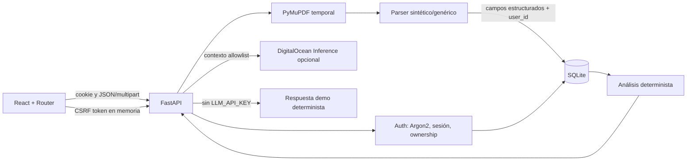

# Arquitectura implementada

SmartBill AI es un monorepositorio con React/TypeScript y Vite, una API FastAPI y SQLite/SQLAlchemy. La landing y la demo sintética son públicas; el área `/app` requiere cuenta y muestra únicamente las facturas de esa cuenta. El proyecto es independiente de GdO y la colección demo usa cifras sintéticas.



## Rutas y límites de confianza

| Ruta | Acceso | Datos |
|---|---|---|
| `/` | Público | Landing |
| `/demo` | Público | Colección sintética fijada explícitamente |
| `/login`, `/registro` | Público | Inicio de sesión y alta de cuenta |
| `/app` | Sesión requerida | Facturas y colecciones propias |

El frontend usa React Router para proteger `/app`. El backend valida sesión y propiedad independientemente del control de rutas de cliente. Consultar o cambiar un ID de factura/colección no da acceso a datos de otra cuenta: los objetos no propios se responden como 404. El historial sintético se mantiene separado del espacio privado.

## Autenticación y CSRF

`/api/auth/register` normaliza el correo y almacena la contraseña con hash Argon2; `/login` valida credenciales. Ambos crean una sesión opaca aleatoria de 14 días y establecen `smartbill_session` como cookie `HttpOnly`, `SameSite=Lax`; se marca `Secure` en producción o si `SESSION_COOKIE_SECURE=true`. En la tabla de sesiones se guarda el SHA-256 del valor de cookie, no el token en claro. `/api/auth/me` devuelve identidad y token CSRF; el cliente lo conserva solo en memoria y limpia estado de consultas al cerrar sesión.

Login/registro validan el encabezado `Origin` contra `FRONTEND_ORIGIN`. Mutaciones autenticadas como logout y carga de PDFs validan origen y `X-CSRF-Token`. El chat de una factura sintética es anónimo; el chat sobre factura privada requiere sesión, origen permitido y token CSRF. `fetch` usa credenciales de cookie. No se usa `localStorage` para credenciales o sesión.

## Facturas y persistencia

PyMuPDF valida PDF y extrae texto seleccionable desde un temporal de hasta 10 MB. Un parser sintético/genérico produce campos normalizados y advertencias; no hay OCR. El PDF original y texto no se persisten. Las facturas de usuario guardan `user_id`; dashboard, lectura, análisis y chat privados filtran por el dueño. Una colección solo puede asignarse a su propietario. El servidor crea tablas SQLite y aplica al arrancar una migración aditiva local para añadir `user_id` a una tabla `invoices` previa.

Las filas antiguas sin propietario (legacy ownerless) se mantienen pero no son visibles para usuarios ni se asignan a una cuenta automáticamente. La demo se siembra con seis facturas ficticias y no se mezcla con las cargas locales.

## Análisis y LLM

El análisis de variaciones es determinista, calculado en backend. Una variación no demuestra una causa ni constituye diagnóstico de seguridad.

Sin `LLM_API_KEY`, el chat funciona en modo demo determinista. Si se configura la clave, DigitalOcean Inference se usa con `LLM_BASE_URL`, `LLM_MODEL` y contexto allowlist de campos estructurados; se excluyen PDF, texto bruto e identificadores privados. La integración se basa en el API compatible con chat completions de [DigitalOcean](https://docs.digitalocean.com/products/inference/how-to/use-chat-completions-api/). No se declara verificada una llamada real al proveedor.

## Modo de demo pública

Para una demo pública configura conjuntamente backend `PUBLIC_DEMO=true` y frontend `VITE_PUBLIC_DEMO=true`. El frontend fija `/demo` a la UUID de colección sintética y no muestra la carga. El backend rechaza cargas y consultas a facturas/colecciones privadas mientras opera en modo público. El flag de frontend solo modifica presentación; el control de acceso efectivo vive en backend.

## Configuración y ejecución

Desde la raíz, en dos terminales:

```bash
cd backend
python3 -m venv .venv
source .venv/bin/activate
pip install -r requirements.txt
cp .env.example .env
python -m uvicorn app.main:app --reload --host 127.0.0.1 --port 8000
```

```bash
cd frontend
npm ci
cp .env.example .env
npm run dev -- --host 127.0.0.1
```

En Windows PowerShell, activa backend con `.venv\Scripts\Activate.ps1`. `backend/.env.example` lista `ENVIRONMENT`, `DATABASE_URL`, `FRONTEND_ORIGIN`, `PUBLIC_DEMO`, `LLM_BASE_URL`, `LLM_API_KEY` (vacía) y `LLM_MODEL`. `frontend/.env.example` lista `VITE_API_BASE_URL` y `VITE_PUBLIC_DEMO`. En producción se necesita HTTPS para cookies `Secure` y un `FRONTEND_ORIGIN` exacto.

## Límites operativos

La autenticación no incluye recuperación de contraseña, verificación de correo, OAuth ni rate limiting. No se ha verificado despliegue público, auditoría de seguridad ni llamada real al LLM. Antes de ofrecer procesamiento público de facturas reales hace falta una revisión operacional y de privacidad, incluyendo tratamiento de datos y controles antiabuso.
