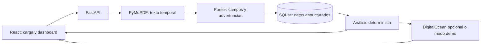

# SmartBill AI — Plan de implementación del MVP

> **Para los futuros agentes Luna:** trabajar tarea por tarea con el contrato y las pruebas indicadas aquí. La coordinación, integración y revisión final quedan a cargo de Codex. No iniciar subagentes ni programar durante la fase de planificación.

**Objetivo:** construir un proyecto de código abierto, demostrable en tres minutos, que lea facturas sintéticas de gas natural, explique consumos y cobros visibles, detecte variaciones y responda preguntas con datos verificados.

**Arquitectura:** monorepositorio con React/TypeScript en el cliente y FastAPI en el servidor. PyMuPDF extrae texto; un parser modular produce un contrato Pydantic; SQLite guarda solo datos estructurados; el análisis numérico es determinista. DigitalOcean Inference, si hay clave, redacta explicaciones sobre datos depurados; sin clave se usa un modo de demostración determinista.

**Stack:** React, TypeScript, Vite, Tailwind, shadcn/ui, Recharts, Lucide, TanStack Query; Python 3.12+, FastAPI, Pydantic v2, PyMuPDF, Pandas, NumPy, SQLAlchemy, SQLite, pytest, HTTPX, DigitalOcean Inference.

**Especificación:** [SMARTBILL_SPEC.md](../../SMARTBILL_SPEC.md).

## 1. Fundamentación y alcance

### Problema y oportunidad

Una factura reúne consumo, período, fechas y cobros, pero interpretar qué cambió entre períodos exige localizar y comparar varias cifras. La CREG describe componentes fijo y variable en el costo del servicio de gas por redes; la Superintendencia de Servicios Públicos señala la importancia de mostrar cómo se determinó y valoró el consumo y cómo se compara con períodos anteriores. SmartBill AI convierte esos datos en una lectura comprensible y trazable, sin calcular tarifas regulatorias ni interpretar causas no demostradas. Fuentes: [CREG, concepto 78 de 2016](https://gestornormativo.creg.gov.co/gestor/entorno/docs/concepto_creg_0000078_2016.htm) y [Superservicios, concepto 570 de 2021](https://gestornormativo.creg.gov.co/gestor/entorno/docs/concepto_superservicios_0000570_2021.htm).

### Hipótesis de producto

Con facturas PDF que contienen texto seleccionable, un usuario puede entender en menos de tres minutos cuánto consumió, cuánto se facturó, qué cambió frente al período anterior y qué información falta para explicar ese cambio. La demo debe permitir verificar cada conclusión contra los campos extraídos. Esta es una hipótesis para evaluar en el portafolio, no una afirmación medida.

### Valor para una postulación

La demostración exhibirá una cadena completa: diseño de interfaz, procesamiento de documentos, contratos API, análisis de datos, integración responsable de IA, pruebas y documentación de código abierto. El README explicará decisiones y límites para que un evaluador pueda reproducirla sin credenciales de pago.

### Límites explícitos

- Proyecto personal e independiente; sin logos oficiales, acceso a sistemas de GdO ni aval de la empresa.
- La demo pública usa solo PDFs sintéticos. La carga de archivos propios se habilita únicamente en ejecución local; un servicio público requeriría otra revisión de privacidad, autenticación y control de acceso.
- Sin OCR, RAG, modelos propios, predicción, pagos, microservicios ni diagnósticos de seguridad de instalaciones.
- Una variación de consumo no demuestra una fuga ni una causa específica.
- El PDF original y su texto completo no se conservan ni se envían al proveedor de IA.

### Código abierto

Publicación propuesta bajo licencia **MIT**, reconocida por la Open Source Initiative; incluir `LICENSE` con el titular y año correctos antes de publicar. Añadir `CONTRIBUTING.md`, `CODE_OF_CONDUCT.md`, `SECURITY.md`, guía de datos sintéticos y registro breve de decisiones. Las contribuciones sobre parsers deberán traer una factura sintética y pruebas, nunca facturas de clientes. Fuente: [OSI, licencia MIT](https://opensource.org/license/mit). La restricción de datos reales responde al tratamiento de datos personales contemplado en la [Ley 1581 de 2012](https://www.funcionpublica.gov.co/eva/gestornormativo/norma.php?i=49981); el documento no sustituye asesoría jurídica.

## 2. Resultado que se demostrará

1. Abrir la aplicación y ver un historial sintético de junio a noviembre, con consumo de 19, 21, 20, 23, 22 y 32 m³.
2. Seleccionar noviembre en el historial sintético. Mostrar período, 32 m³, total ficticio y conceptos disponibles.
3. Mostrar 45,45 % de aumento frente a octubre y la etiqueta «variación alta» por una regla de demostración de más de 30 %. Después, cargar una factura PDF sintética en una colección local separada para enseñar la extracción y las advertencias; para comparar cargas locales, cargar octubre y noviembre en la misma colección.
4. Preguntar «¿Por qué aumentó?» y responder que el consumo subió 10 m³, sin atribuir una causa que el documento no demuestra.
5. Mostrar el modo sin clave de DigitalOcean y una factura incompleta para probar degradación controlada.

**Tiempo objetivo de demostración:** tres minutos. **Esfuerzo orientativo:** 30–45 horas de implementación y revisión; la estimación se ajustará al ejecutar las tareas.

## 3. Contrato técnico común

El coordinador fija este contrato antes de delegar tareas. Un agente puede proponer cambios, pero no modificarlo unilateralmente cuando otro agente ya lo consume.

```json
{
  "InvoiceOut": {
    "id": "uuid",
    "collection_id": "uuid",
    "billing_period": "string|null",
    "issued_on": "YYYY-MM-DD|null",
    "due_on": "YYYY-MM-DD|null",
    "consumption_m3": "decimal|null",
    "total_cop": "integer|null",
    "fixed_charge_cop": "integer|null",
    "variable_charge_cop": "integer|null",
    "line_items": [{"label": "string", "amount_cop": "integer"}],
    "warnings": ["string"],
    "source": "synthetic|local_upload"
  },
  "AnalysisOut": {
    "current_consumption_m3": "decimal|null",
    "previous_consumption_m3": "decimal|null",
    "variation_percentage": "decimal|null",
    "historical_average_m3": "decimal|null",
    "status": "high_variation|significant_decrease|within_threshold|insufficient_data",
    "message": "string"
  }
}
```

**Reglas de contrato:** COP se representa como entero; los m³ se guardan como `Decimal` y se serializan de modo consistente; campos no identificados son `null` con advertencia; fechas usan ISO 8601; el servidor calcula porcentajes y el cliente solo los formatea. `collection_id` agrupa únicamente facturas que el usuario asocia explícitamente; una carga aislada no se compara automáticamente con el historial sintético. El identificador público es un UUID generado, nunca el número real de factura.

**API:** `GET /health`, `POST /api/invoices/upload` (PDF y `collection_id` opcional), `GET /api/invoices/{id}`, `GET /api/invoices/{id}/analysis`, `GET /api/dashboard?collection_id=...`, `POST /api/chat`. Errores con `{ "error": { "code": "...", "message": "..." } }`; HTTP 400 para archivo/formato inválido, 413 para tamaño, 404 para recurso inexistente y 503 para proveedor de IA no disponible. `/docs` queda activo en local.

**Modo de ejecución:** `PUBLIC_DEMO=true` sirve solo datos sintéticos y deshabilita `POST /api/invoices/upload`; `PUBLIC_DEMO=false` permite cargas locales. `LLM_API_KEY` de DigitalOcean es opcional y solo vive en el backend. Cambio de alcance solicitado después de la especificación original: DigitalOcean sustituye a Gemini como proveedor.



## 4. Mapa de archivos previsto

| Ruta | Responsabilidad |
|---|---|
| `backend/app/main.py`, `backend/app/core/config.py` | FastAPI, CORS, límites, modo público y configuración |
| `backend/app/schemas/invoice.py`, `analysis.py`, `chat.py` | Contratos Pydantic compartidos como referencia del cliente |
| `backend/app/services/pdf_extractor.py` | Validar firma, abrir PDF y extraer texto temporalmente |
| `backend/app/services/parsers/base.py`, `synthetic.py`, `generic.py` | Adaptadores de formato y resultado con advertencias |
| `backend/app/services/consumption_analyzer.py` | Cálculo y clasificación deterministas |
| `backend/app/services/ai_service.py`, `prompts/v1.py` | Proveedor DigitalOcean, modo demo y prompt versionado |
| `backend/app/database/models.py`, `session.py`, `seed.py` | SQLite, persistencia estructurada y datos sintéticos |
| `backend/app/api/invoices.py`, `analysis.py`, `dashboard.py`, `chat.py` | Endpoints del contrato |
| `backend/tests/` | Pruebas unitarias y HTTPX con fixtures sintéticas |
| `frontend/src/lib/api.ts`, `types/api.ts` | Cliente HTTP y tipos alineados con Pydantic |
| `frontend/src/components/`, `pages/`, `hooks/` | Diseño, dashboard, carga, análisis y chat |
| `frontend/src/index.css`, `components.json` | Tokens visuales, Tailwind y shadcn/ui |
| `samples/synthetic_invoices/`, `scripts/generate_samples.py` | PDFs ficticios reproducibles |
| `docs/ARCHITECTURE.md`, `API.md`, `DEMO.md`, `DECISIONS.md` | Fundamento, decisiones, contrato y guion |
| `README.md`, `LICENSE`, `CONTRIBUTING.md`, `CODE_OF_CONDUCT.md`, `SECURITY.md` | Presentación y gobierno de código abierto |

**Guía visual compartida:** [design-system/smartbill-ai/MASTER.md](../../../design-system/smartbill-ai/MASTER.md), creada con `ui-ux-pro-max`. Al implementar, el agente de UI debe leer la skill instalada en `/Users/j/.codex/skills/ui-ux-pro-max/SKILL.md`, aplicar el sistema visual a React/Tailwind/shadcn y verificar contraste, teclado, estados y anchos de 375, 768, 1024 y 1440 px. Nada de Streamlit. La página inicial debe sentirse como una aplicación real, no como una maqueta de presentación.

## 5. Tareas para agentes Luna

Cada tarea termina con archivos integrables, salida de comandos ejecutados y riesgos observados. El coordinador revisa el contrato, ejecuta la comprobación pertinente y corrige incompatibilidades antes de desbloquear dependientes. Los agentes no hacen commits ni despliegues por su cuenta.

### Tarea 1 — Base ejecutable y contrato

**Dependencia:** ninguna. **Dueño:** agente Luna backend/base. **Archivos:** `backend/app/main.py`, `core/config.py`, `schemas/*`, `database/session.py`, `frontend/package.json`, `frontend/src/main.tsx`, `frontend/src/types/api.ts`, ejemplos de entorno.

- [ ] Crear FastAPI y Vite/React TypeScript; instalar solo las dependencias exigidas por la especificación.
- [ ] Definir las clases `InvoiceOut`, `AnalysisOut`, `ChatRequest`, `ChatResponse` y los tipos TypeScript equivalentes, incluyendo `null` y códigos de estado exactos.
- [ ] Configurar SQLite local, `GET /health`, CORS para el origen local de Vite y `.env.example` sin secretos.
- [ ] Crear prueba HTTPX que compruebe `GET /health == 200` y una página React inicial que compile.
- [ ] Ejecutar `cd backend && python -m pytest -q` y `cd frontend && npm run build`; entregar los resultados reales.

**Aceptación:** backend y frontend arrancan desde cero y el contrato está publicado en `docs/API.md` como borrador.

### Tarea 2 — Facturas sintéticas y extracción

**Dependencia:** tarea 1. **Dueño:** agente Luna documentos/backend. **Archivos:** `scripts/generate_samples.py`, `samples/synthetic_invoices/*`, `backend/app/services/pdf_extractor.py`, `backend/app/services/parsers/*`, `backend/tests/test_pdf_extractor.py`, `test_invoice_parser.py`.

- [ ] Generar PDFs reproducibles para seis meses y cuatro casos: normal, salto a 32 m³, campos incompletos y archivo inválido. Todos deben decir «Datos sintéticos de demostración».
- [ ] Validar extensión, MIME real, firma `%PDF-`, máximo inicial de 10 MB y páginas legibles; usar archivo temporal y borrarlo al finalizar.
- [ ] Extraer texto con PyMuPDF y pasarlo a adaptadores; el adaptador sintético reconoce la plantilla de demo y el genérico busca campos conocidos sin suponer posiciones fijas.
- [ ] Producir `ParseResult(invoice: InvoiceOut, warnings: list[str])`; si falta un campo, devolver `null`, no un valor aproximado.
- [ ] Probar PDF válido, no PDF, tamaño excesivo, campos disponibles, faltantes y PDF sin texto seleccionable. No usar OCR.

**Aceptación:** el PDF de noviembre extrae 32 m³; el incompleto devuelve advertencias; los errores no filtran el texto del documento.

### Tarea 3 — Persistencia y API de facturas

**Dependencia:** tareas 1 y 2. **Dueño:** agente Luna API. **Archivos:** `backend/app/database/models.py`, `seed.py`, `backend/app/api/invoices.py`, `backend/tests/test_invoice_api.py`.

- [ ] Persistir solo campos estructurados, conceptos y advertencias; nunca PDF ni texto completo.
- [ ] Crear semilla sintética idempotente con una colección de seis períodos; una carga local nueva recibe colección propia salvo `collection_id` proporcionado explícitamente.
- [ ] Implementar `POST /api/invoices/upload` y `GET /api/invoices/{id}` con errores tipados y 404 para UUID no encontrado. Leer la subida por bloques para aplicar el límite antes de cargarla completa en memoria.
- [ ] En `PUBLIC_DEMO=true`, rechazar la subida y exponer únicamente la colección sintética.
- [ ] Probar la respuesta de subida, lectura posterior, separación de colecciones y ausencia de datos personales en el JSON y logs.

**Aceptación:** una factura sintética cargada se consulta por ID y no contamina otra serie histórica.

### Tarea 4 — Análisis determinista y dashboard API

**Dependencia:** tareas 1 y 3. **Dueño:** agente Luna análisis. **Archivos:** `backend/app/services/consumption_analyzer.py`, `backend/app/api/analysis.py`, `dashboard.py`, `backend/tests/test_analysis.py`, `test_dashboard_api.py`.

- [ ] Implementar `analyze(current, previous, history, threshold=30)` con `Decimal`: porcentaje `((actual - anterior) / anterior) * 100` y dos decimales.
- [ ] Si anterior falta o es cero, devolver `variation_percentage=null` y `status=insufficient_data`.
- [ ] Etiquetar más de +30 % como `high_variation`, menos de -30 % como `significant_decrease`; el resto `within_threshold`. Los límites exactos ±30 % quedan dentro del umbral.
- [ ] Calcular promedio del historial válido; usar Pandas para la serie ordenada y NumPy para mediana/MAD solo si hay al menos cuatro consumos históricos comparables. Indicar que son estadísticas descriptivas, no riesgos de seguridad.
- [ ] Implementar análisis por factura y dashboard por colección, ordenados por período; probar 22→32 = 45,45 %, cero, faltantes, umbrales y orden.

**Aceptación:** el servidor devuelve un resultado reproducible y ningún texto indica fuga de gas.

### Tarea 5 — Sistema visual y pantalla principal

**Dependencia:** tarea 1; puede avanzar en paralelo con tareas 2–4. **Dueño:** agente Luna UI. **Archivos:** `frontend/src/index.css`, `components/*`, `pages/DashboardPage.tsx`, `pages/InvoicesPage.tsx`, `hooks/*`, `lib/api.ts`.

- [ ] Leer `ui-ux-pro-max` y la guía visual del proyecto; crear tokens semánticos con fondo claro, azul marino, acento verde, tipografía legible, espaciado coherente y movimiento discreto.
- [ ] Construir sidebar adaptable, encabezado, KPI, gráficos de consumo y costo, panel de análisis, listado de facturas y CTA de carga con shadcn/ui, Recharts y Lucide.
- [ ] Conectar TanStack Query al contrato. Formatear COP con `Intl.NumberFormat('es-CO', { style: 'currency', currency: 'COP' })` y m³ con formato local.
- [ ] Diseñar estados vacío, carga, error, factura incompleta y demo pública; el mensaje de datos sintéticos debe ser visible.
- [ ] Ejecutar `npm run build` y revisar visualmente 375, 768, 1024 y 1440 px, navegación por teclado, contraste, etiquetas de gráficos y `prefers-reduced-motion`.

**Aceptación:** la pantalla es usable en móvil y escritorio, muestra los números de la API y tiene una jerarquía visual clara. No usar Streamlit.

### Tarea 6 — Carga de PDF en la UI

**Dependencia:** tareas 3 y 5. **Dueño:** agente Luna UI/integración. **Archivos:** `frontend/src/components/InvoiceUploader.tsx`, `pages/InvoicesPage.tsx`, `hooks/useInvoiceUpload.ts`.

- [ ] Dar selector de archivo y arrastrar/soltar con la misma ruta de validación; mostrar máximo de 10 MB y solo PDF.
- [ ] Mostrar progreso de envío, estado de procesamiento, éxito, advertencias de extracción y errores del API cerca del control.
- [ ] Al completar, invalidar consultas de factura/dashboard y navegar a la factura recién creada.
- [ ] En demo pública, explicar por qué solo hay facturas sintéticas y ocultar la acción de carga.
- [ ] Revisar con teclado, lector de pantalla básico y archivos válido, inválido y excesivo; ejecutar `npm run build`.

**Aceptación:** carga local completa sin recargar la página; los fallos dejan una acción clara para reintentar.

### Tarea 7 — Servicio de IA y chat API

**Dependencia:** tareas 3 y 4. **Dueño:** agente Luna IA/backend. **Archivos:** `backend/app/services/ai_service.py`, `prompts/v1.py`, `backend/app/api/chat.py`, `backend/tests/test_chat.py`, `test_ai_privacy.py`.

- [ ] Definir `ChatRequest(invoice_id: UUID, question: str)` y `ChatResponse(answer: str, mode: 'digitalocean'|'demo', evidence: list[str])`.
- [ ] Construir un objeto de contexto permitido solo con campos validados y análisis determinista; excluir PDF, texto bruto, identificadores personales y rutas.
- [ ] Implementar respuestas demo para consumo, cobros, variación y datos insuficientes; el chat debe funcionar sin API key.
- [ ] Encapsular DigitalOcean Inference detrás de una interfaz de proveedor OpenAI-compatible, modelo por `LLM_MODEL` y prompt `v1`; aplicar tiempo límite y error controlado. No permitir que instrucciones halladas en PDF cambien el comportamiento.
- [ ] Probar preguntas sobre 32 m³ y 45,45 %, ausencia de clave, campos faltantes, intento de inyección y que el payload al proveedor no contiene texto ni identificadores del PDF. Mensajes de emergencia se responden con recomendación de alejarse y contactar canales oficiales desde lugar seguro.

**Aceptación:** la respuesta cita los campos usados o reconoce que faltan datos; no inventa tarifas, causas ni diagnósticos.

### Tarea 8 — Chat contextual en la UI

**Dependencia:** tareas 5 y 7. **Dueño:** agente Luna UI. **Archivos:** `frontend/src/components/InvoiceChat.tsx`, `pages/AnalysisPage.tsx`, `hooks/useChat.ts`.

- [ ] Asociar cada consulta al `invoice_id` visible y limitar el historial al estado de la sesión actual.
- [ ] Añadir preguntas sugeridas, indicador de respuesta, error recuperable y etiqueta visible de modo demo o DigitalOcean.
- [ ] Mostrar la evidencia como campos de la factura y distinguir consumo en m³ de valor en COP.
- [ ] Verificar envío con Enter y botón, foco tras respuesta, mensajes largos, pantalla móvil y desconexión del backend.
- [ ] Ejecutar `npm run build` y una prueba manual con el PDF sintético de noviembre.

**Aceptación:** el asistente responde sobre la factura seleccionada y nunca mezcla datos de otra colección.

### Tarea 9 — Endurecimiento, integración y pruebas completas

**Dependencia:** tareas 1–8. **Dueño:** coordinador Codex con correcciones puntuales delegables. **Archivos:** toda la aplicación y pruebas.

- [ ] Ejecutar backend y frontend desde instalación limpia con `.env.example`; probar flujo de carga → extracción → análisis → dashboard → chat.
- [ ] Ejecutar los diez casos obligatorios de la especificación y corregir fallos; registrar comandos, número de pruebas y resultado real.
- [ ] Verificar archivo temporal eliminado, ausencia de secretos, rutas arbitrarias, logs de datos personales y CORS abierto.
- [ ] Revisar visualmente los estados indicados y el guion de tres minutos; corregir desbordes, contraste y controles inaccesibles.
- [ ] Preparar `Dockerfile` del backend y configuración del frontend para Vercel, sin desplegar.

**Aceptación:** todos los criterios del apartado 7 se cumplen en local; cualquier excepción queda documentada como limitación comprobada.

### Tarea 10 — Documentación y presentación de código abierto

**Dependencia:** tareas 1–9. **Dueño:** agente Luna documentación; revisión final del coordinador. **Archivos:** `README.md`, `LICENSE`, `CONTRIBUTING.md`, `CODE_OF_CONDUCT.md`, `SECURITY.md`, `docs/ARCHITECTURE.md`, `API.md`, `DEMO.md`, `DECISIONS.md`.

- [ ] Escribir README en español: problema fundamentado, captura real, alcance, diagrama simple, instalación, variables, pruebas, modo demo, límites y hoja de ruta.
- [ ] Documentar por qué parser modular, SQLite, análisis determinista y DigitalOcean opcional; enlazar fuentes oficiales y dejar claro el carácter independiente del proyecto.
- [ ] Publicar licencia MIT con nombre/año correctos, normas de contribución, reporte privado de vulnerabilidades y prohibición de subir facturas reales a issues o PRs.
- [ ] Preparar `docs/DEMO.md` con pasos cronometrados para 180 segundos y respuestas esperadas verificables.
- [ ] Seguir el README desde cero en una instalación limpia; corregir cada instrucción que falle.

**Aceptación:** una persona ajena al proyecto puede arrancar la demo, ejecutar pruebas y entender qué se probó y qué no.

## 6. Orquestación posterior de agentes Luna

**Regla de trabajo:** Codex coordina y revisa; cada agente Luna recibe una tarea delimitada con archivos permitidos, interfaces, prueba esperada y formato de entrega. Máximo tres agentes en ejecución simultánea para dejar un puesto al coordinador. Los agentes que compartan archivos no trabajan en paralelo; se usa una sola rama/directorio compartido con bloqueos de responsabilidad por archivo o, si se necesita aislamiento, worktrees separados gestionados por el coordinador.

| Ola | Trabajo paralelo permitido | Puerta de integración |
|---|---|---|
| 1 | Tarea 1 | Contratos Pydantic/TypeScript y arranque aprobados |
| 2 | Tarea 2 y Tarea 5 | Fixtures/parsers y sistema visual verificados |
| 3 | Tarea 3, luego Tarea 4; Tarea 5 puede continuar solo en archivos propios | API de factura y análisis estable |
| 4 | Tareas 6 y 7 | Flujo de carga y respuestas del backend comprobados |
| 5 | Tarea 8 | Chat visual conectado y revisado |
| 6 | Tareas 9 y 10, con documentación escrita sobre resultados reales | Demo reproducible y documentación exacta |

**Mensaje base para cada agente:** «Implementa solo la Tarea N del plan y lee la especificación, el contrato común y las rutas asignadas. Muestra archivos modificados, decisiones, comandos ejecutados, resultados reales y riesgos. No hagas commits, no despliegues, no cambies contratos compartidos ni edites archivos de otro agente sin avisar al coordinador». En UI se añade: «Lee y aplica `ui-ux-pro-max` y el `MASTER.md`; usa React/Vite/Tailwind/shadcn, nunca Streamlit».

**Revisión del coordinador por tarea:** inspeccionar diff, ejecutar pruebas relevantes, comprobar que se respetan interfaces, revisar casos límite y aprobar o devolver correcciones concretas. Al terminar cada ola, ejecutar una prueba del flujo ya integrado. No afirmar éxito de pruebas no ejecutadas. El trabajo remoto, commits, push y despliegue se tratan como pasos posteriores al MVP local.

## 7. Criterios de cierre verificables

- [ ] `GET /health` responde 200 y `/docs` presenta los endpoints.
- [ ] Los PDFs sintéticos se generan con un comando documentado y están marcados como ficticios.
- [ ] La carga local rechaza formato falso y más de 10 MB; la demo pública no permite carga.
- [ ] El parser entrega valores presentes y `null` + advertencia para los ausentes.
- [ ] La factura de noviembre muestra 32 m³; la comparación con octubre de 22 m³ da 45,45 %.
- [ ] Un anterior cero o inexistente produce `insufficient_data` sin división por cero.
- [ ] Dashboard y chat muestran la misma factura/colección, COP en formato `es-CO` y datos sin inventar.
- [ ] El modo sin `LLM_API_KEY` permite demostrar todas las preguntas principales.
- [ ] El proveedor de IA recibe únicamente campos depurados; no recibe PDF ni texto completo.
- [ ] Las diez pruebas obligatorias pasan y se registran los resultados ejecutados.
- [ ] UI revisada en móvil y escritorio, con teclado, contraste, estado vacío y errores claros.
- [ ] README, licencia, guía de contribución, arquitectura, API y guion de 180 segundos están completos.

## 8. Riesgos y decisiones de alcance

| Riesgo | Señal temprana | Decisión para el MVP |
|---|---|---|
| PDFs de formatos distintos | Campos ausentes en una nueva plantilla | Adaptadores; advertencias explícitas; no inferir valores |
| PDF escaneado | PyMuPDF no obtiene texto | Mensaje «requiere texto seleccionable»; OCR fuera de alcance |
| Comparación equivocada | Facturas de hogares distintos en un gráfico | `collection_id` explícito y aislamiento por colección |
| Respuesta de IA engañosa | Atribuye causas sin evidencia | Contexto estructurado, prompt versionado, modo demo y pruebas |
| Datos personales en repo/demo | Nombres/direcciones en fixtures o logs | Solo datos sintéticos; no persistir PDF; revisión de privacidad |
| Demostración dependiente de red | DigitalOcean falla o no hay clave | Respuestas deterministas locales y datos semilla |
| UI vistosa pero confusa | Valores difíciles de leer o estados ocultos | Sistema visual, jerarquía, accesibilidad y revisión a 375–1440 px |

## 9. Fuera del MVP y siguiente iteración

OCR, autenticación, múltiples cuentas reales, revisión legal para tratamiento de datos, más adaptadores, telemetría, despliegue público de cargas, modelos predictivos y análisis tarifario quedan para iteraciones posteriores. Se prioriza una cadena completa y verificable con datos sintéticos.
